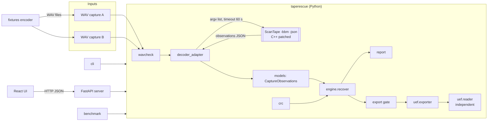

# Design Document: TapeRescue

## Overview

TapeRescue turns one or two PCM WAV captures of a BBC Micro 1200-baud cassette into per-block observations, merges them, reconstructs blocks that fail in every capture when the recorded data CRC identifies exactly one combination of observed bytes, and writes a `.uef` tape image plus a JSON recovery report with byte-level provenance.

The system has four layers with one-way dependencies:

1. **Decoder layer (C++)**: AtomTapeUtils `ScanTape` at revision `98d1a8d1bed00aa22f1d72e3d5e91a254a69ec64`, built from `third_party/` with one tracked patch that adds a JSON block-observation mode.
2. **Python core (`taperescue` package)**: WAV validation, decoder adapter, CRC, recovery engine, report, UEF exporter, independent UEF reader, fixture encoder, benchmark, and CLI. The recovery engine imports only data models and the CRC module. It never imports the decoder adapter, WAV code, or web code.
3. **Web API (FastAPI)**: session handling, upload validation, and downloads. It calls the same Python core as the CLI.
4. **Web UI (Vite, React, TypeScript)**: capture strips, merged strip, block inspector, and download controls.

Key design decisions:

| Decision | Choice | Reason |
| --- | --- | --- |
| Where to read observations | Patch `ScanTape` at the block decoder boundary | File assembly zero-pads partial data (brief, `FileDecoder.cpp`). Observations must be raw. |
| Capture_ID | Full lowercase SHA-256 hex of the WAV bytes, computed in Python and passed to the decoder with `-capture-id` | Keeps SHA-256 out of C++ and makes the ID stable across runs and upload order. |
| Engine purity | `recover(captures, options) -> RecoveryResult` is a pure function over immutable dataclasses | Enables Hypothesis tests, order independence, and reuse by CLI, API, and benchmark. |
| Candidate cap check | Compute the candidate count as a product before enumerating | Requirement 9.3 forbids evaluating any candidate when the cap is exceeded. |
| CRC values in export | Exporter writes the CRC bytes recorded in the captures and never recomputes them | Requirement 11.3. Recomputing would only test internal consistency. |
| UEF reader | Separate module with its own chunk parser and its own CRC routine | Requirement 11.4 asks for an independent reader. |
| Fixture encoder | Pure Python, no decoder imports, integer sample timing | Requirements 4.8 and 4.9. |
| Report determinism | No timestamps or local paths in the report; JSON written with sorted keys | Requirement 10.6. |

## Architecture



### Repository layout

```
/
├── LICENSE                                  # MIT for project code
├── THIRD_PARTY_NOTICES.md
├── README.md
├── VERIFICATION_LOG.md                      # Verification_Log
├── Dockerfile
├── third_party/AtomTapeUtils/               # pinned source, upstream LICENSE untouched
├── patches/atomtapeutils-json-observations.patch
├── scripts/build_decoder.sh                 # applies patch, builds to build/decoder/ScanTape
├── taperescue/
│   ├── models.py                            # dataclasses shared by all layers
│   ├── crc.py
│   ├── wavcheck.py
│   ├── decoder_adapter/
│   │   ├── __init__.py
│   │   ├── run.py                           # subprocess invocation
│   │   └── schema.py                        # observation schema + parser
│   ├── engine/
│   │   ├── __init__.py                      # recover()
│   │   ├── matching.py                      # identity keys, anchors, conflicts
│   │   ├── selection.py                     # intact selection
│   │   ├── reconstruct.py                   # bounded candidate search
│   │   ├── gate.py                          # export decision
│   │   └── report.py                        # report building + JSON
│   ├── uef/
│   │   ├── exporter.py
│   │   └── reader.py                        # imports nothing from exporter or crc
│   ├── fixtures/
│   │   ├── tokenizer.py
│   │   ├── block_builder.py
│   │   ├── damage.py
│   │   ├── fsk.py
│   │   └── starmap.py                       # orchestrates fixture generation
│   ├── benchmark.py
│   └── cli.py
├── fixtures/starmap/
│   ├── STARMAP.bas
│   ├── clean.wav, damaged_a.wav, damaged_b.wav
│   ├── reference_payloads.json              # per-block hex + SHA-256
│   └── damage.json                          # offsets, original and damaged values
├── server/app.py, server/sessions.py
├── web/                                     # Vite + React + TypeScript
├── benchmarks/results.json, benchmarks/results.md
├── tests/                                   # pytest + Hypothesis
└── .kiro/hooks/recovery-tests.json
```

## Components and Interfaces

### 1. Decoder build and patch (C++)

`scripts/build_decoder.sh`:

1. If `third_party/AtomTapeUtils` is absent, run `git clone` and `git checkout 98d1a8d1bed00aa22f1d72e3d5e91a254a69ec64`. On failure, print `failed to fetch AtomTapeUtils revision 98d1a8d1...` to stderr and exit 2 (Requirement 1.4).
2. Verify `git rev-parse HEAD` in the vendored tree equals the pinned revision when the tree is a git checkout. Otherwise verify `third_party/AtomTapeUtils/REVISION`.
3. Copy the tree to `build/decoder-src/`, run `git apply --check` and then `git apply patches/atomtapeutils-json-observations.patch`. The vendored tree stays unpatched, so `LICENSE` and notices are unchanged (Requirement 1.1, 1.2).
4. Build with the upstream CMake files into `build/decoder/ScanTape`. No network access is needed once the source is present (Requirement 1.3).

The patch adds:

- CLI options `-json <path>` and `-capture-id <hex>` to `ScanTape/ArgParser.cpp`, valid with `-bbm`.
- A small `ObservationWriter` (`shared/ObservationWriter.h/.cpp`) with a hand-written JSON emitter. No new third-party dependency.
- A hook in `shared/BlockDecoder.cpp` after the header is read and after the data and data CRC reads finish or fail. The hook records the raw bytes the decoder actually read. It is called before any `FileDecoder` assembly, so no padding is applied (Requirement 2.1, 2.5).

The hook must capture three cases that the stock decoder may short-circuit:

- Data CRC mismatch: keep reading to the declared length and record the bytes and the recorded CRC (Requirement 2.3).
- Early end of signal or lost carrier inside the payload: record bytes read so far, `actual_len < expected_len` (Requirement 2.4).
- CRC bytes not readable: `outcome = "unreadable"`, value omitted (Requirement 2.7).

If milestone 1 shows that the block decoder cannot surface any of these (for example, it aborts on a framing error before the data CRC), the patch moves the hook down to the byte reader and the unsupported failure modes are recorded in `VERIFICATION_LOG.md` (Requirement 2.9).

Observation JSON emitted by the patched decoder (schema version 1):

```json
{
  "schema": "taperescue.observations/1",
  "capture_id": "3f5a...e1",
  "decoder": {"name": "AtomTapeUtils ScanTape", "revision": "98d1a8d1bed00aa22f1d72e3d5e91a254a69ec64", "mode": "bbm"},
  "blocks": [
    {
      "sample_offset": 225117,
      "time_s": 5.1047,
      "header_raw": "535441524d41500000...",
      "header": {"filename": "STARMAP", "load_addr": 4294905344, "exec_addr": 4294934563,
                 "block_no": 6, "block_len": 256, "flags": 0, "next_addr": 0},
      "header_crc": {"recorded": 41257, "outcome": "valid"},
      "payload": "0d000a1df1...",
      "expected_len": 256,
      "actual_len": 256,
      "data_crc": {"recorded": 4660, "outcome": "invalid"}
    }
  ]
}
```

`header_raw` covers the bytes from the filename through the next-file address, excluding the `0x2A` sync byte and the header CRC. `header` is `null` when the header CRC is `invalid` or `unreadable` and the fields cannot be parsed. `recorded` is omitted when `outcome` is `unreadable`.

### 2. WAV validation (`taperescue/wavcheck.py`)

```python
@dataclass(frozen=True)
class WavInfo:
    format_tag: int
    sample_rate: int
    bits_per_sample: int
    channels: int
    data_bytes: int
    duration_s: float

class WavRejected(Exception):
    code: Literal["not_riff_wave", "unsupported_format", "too_large", "too_long", "no_data"]
    message: str

MAX_BYTES = 64 * 1024 * 1024
MAX_SECONDS = 600

def inspect_wav_header(head: bytes, file_size: int) -> WavInfo: ...
def validate_capture(path: Path) -> WavInfo: ...   # raises WavRejected
```

The parser walks RIFF chunks itself rather than trusting the file extension. It accepts `WAVE_FORMAT_PCM` (1) and `WAVE_FORMAT_EXTENSIBLE` with the PCM sub-format GUID. Rejection messages state the detected values and the supported format, for example `Detected 48000 Hz, 16-bit, 2 channels; TapeRescue supports 44100 Hz, 16-bit, mono PCM` (Requirement 3.1, 3.2). The size check runs on the byte count before parsing; duration is `data_bytes / (sample_rate * block_align)` (Requirement 3.3).

### 3. Decoder adapter (`taperescue/decoder_adapter/`)

```python
class DecoderError(Exception):
    capture_id: str
    code: Literal["timeout", "decoder_failed", "invalid_output", "no_blocks"]
    message: str

def capture_id_for(path: Path) -> str: ...                 # SHA-256 hex of file bytes

def decode_capture(wav: Path, *, decoder: Path, workdir: Path,
                   timeout_s: float = 60.0) -> CaptureObservations:
    """Runs [decoder, "-bbm", "-json", str(out), "-capture-id", cid, str(wav)]
    with subprocess.run(args, shell=False, timeout=timeout_s, capture_output=True).
    out is a generated path inside workdir."""

def parse_observations(doc: dict, expected_capture_id: str) -> CaptureObservations:
    """Validates the schema; raises DecoderError(code="invalid_output") naming the capture id."""
```

Validation rules in `schema.py` (Requirement 2.8):

- `capture_id` equals the expected ID.
- `len(bytes.fromhex(payload)) == actual_len` and `actual_len <= expected_len`.
- `expected_len == header.block_len` when the header is valid.
- `recorded` present if and only if `outcome != "unreadable"`; values are in `0..0xFFFF`.
- `outcome == "valid"` for a data CRC requires `actual_len == expected_len`.

`subprocess.TimeoutExpired` becomes `DecoderError(code="timeout")`. `subprocess.run` kills the child on timeout (Requirement 3.4). Zero observations with a valid header becomes `code="no_blocks"` with the message `No BBC 1200-baud blocks were found in this capture` (Requirement 3.5).

### 4. CRC (`taperescue/crc.py`)

```python
def crc16_xmodem(data: bytes, init: int = 0x0000) -> int:
    """Polynomial 0x1021, no reflection, xorout 0x0000. Table-driven."""
```

The BBC format stores CRCs high byte first. Header CRC covers filename through next-file address. Data CRC covers the payload only.

### 5. Recovery engine (`taperescue/engine/`)

Public entry point:

```python
@dataclass(frozen=True)
class RecoverOptions:
    reconstruct: bool = True
    candidate_cap: int = 64

class PairingRejected(Exception):
    code: Literal["no_anchor"]
    message: str   # "These recordings cannot be shown to belong to the same program.
                   #  Select recordings of the same program version."

def recover(captures: Sequence[CaptureObservations],
            options: RecoverOptions = RecoverOptions()) -> RecoveryResult: ...
```

`recover` runs these steps:

1. **Normalise inputs.** Drop captures with a repeated `capture_id` and record the dropped duplicates in `duplicates_merged` (Requirement 3.6). Sort captures by `capture_id`. Sort each capture's reads by `(block_no, sample_offset)`. Every later step iterates in this order, so upload order cannot affect any output (Requirement 8.3, 10.6).
2. **Identity candidates.** A read is an identity candidate only if `header_crc.outcome == "valid"` (Requirement 7.1). Its identity key is `(filename, load_addr, exec_addr, block_no, block_len, flags)` (Requirement 7.2). `next_addr` is reported but not matched.
3. **Anchors (two captures).** An anchor is a block number where each capture has an Intact_Block with equal identity keys and equal payload bytes. Anchors are computed before any other block is paired (Requirement 7.3). With zero anchors, `recover` raises `PairingRejected` (Requirement 7.4). A single capture skips this step.
4. **Block range.** The final block is the lowest block number among identity candidates whose flags have bit 7 set. Required blocks are `0..final`. With no flagged block, required blocks are `0..max(block_no)` and the gate refuses export with reason `block_missing` on a synthetic "final block" entry.
5. **Per-block decision**, in this order:

| Step | Condition | Result |
| --- | --- | --- |
| a | No reads at all for `n` | `Missing`, `block_missing` |
| b | Reads exist, none with valid header | `Unresolved`, `header_invalid` |
| c | Identity keys of valid-header reads differ | `Conflict`, `header_disagreement`, conflicting capture IDs; excluded from reconstruction (Requirement 7.5) |
| d | One or more Intact_Blocks, payloads differ | `Conflict`, `conflict.kind = "payload"`, both capture IDs (Requirement 7.6) |
| e | One or more Intact_Blocks, payloads equal | `Intact`; supporting IDs are every capture with that intact payload (Requirement 8.1, 8.2, 8.4) |
| f | Session has one capture | `CRC failed`, `single_read` (Requirement 9.11) |
| g | `options.reconstruct` is false (intact-only baseline) | `CRC failed`, reason omitted, `reconstruction.attempted = false` (Requirement 14.2) |
| h | Fewer than two valid-header reads | `Unresolved`, `single_read` |
| i | Any valid-header read truncated | `Unresolved`, `truncated_payload` (Requirement 9.10) |
| j | Any data CRC unreadable | `Unresolved`, `crc_unreadable` (Requirement 9.8) |
| k | Recorded data CRC values differ | `Unresolved`, `crc_mismatch_between_reads` (Requirement 9.9) |
| l | Otherwise | Bounded reconstruction (below) |

Reads with an invalid header CRC never supply bytes, CRCs, or identity. They appear in the report under `reads` with their outcomes only.

**Bounded reconstruction** (`reconstruct.py`):

```python
@dataclass(frozen=True)
class OffsetChoice:
    offset: int
    observed: tuple[tuple[str, int], ...]   # (capture_id, value) sorted by capture_id
    chosen: int | None
    supporting_capture_ids: tuple[str, ...]

@dataclass(frozen=True)
class ReconstructionOutcome:
    candidate_count: int
    evaluated_count: int
    match_count: int
    payload: bytes | None
    choices: tuple[OffsetChoice, ...]
    reason: UnresolvedReason | None

def candidate_count(reads: Sequence[bytes]) -> int:
    """Exact product of distinct observed values per differing offset.
    Computed without building any candidate."""

def reconstruct(reads: Sequence[bytes], recorded_crc: int, cap: int) -> ReconstructionOutcome: ...
```

- Differing offsets are positions where the reads do not all agree. Distinct values at each offset are sorted ascending.
- The count is the product of the distinct-value counts. Python integers do not overflow, so the exact count is reported (for example 128 in Requirement 12.4).
- If the count exceeds the cap: `Unresolved`, `cap_exceeded`, `evaluated_count = 0`, `match_count` absent (Requirement 9.3).
- Otherwise every candidate from `itertools.product` is built and checked with `crc16_xmodem` against the recorded CRC (Requirement 9.4). The search never stops at the first match.
- One match: `Reconstructed · CRC match`, `payload` set, each `OffsetChoice.chosen` and `supporting_capture_ids` filled (Requirement 9.5).
- Zero matches: `no_match` (Requirement 9.6). More than one: `multiple_matches` with `match_count` (Requirement 9.7). In both cases `payload` is `None`.
- Zero differing offsets gives one candidate. If it fails, the result is `no_match`.

The reconstructed payload is only ever built from observed values, and the recorded CRC is never replaced. An Unresolved block carries no payload in the result (Requirement 9.12).

**Export gate** (`gate.py`):

```python
@dataclass(frozen=True)
class ExportDecision:
    permitted: bool
    blockers: tuple[tuple[int, str], ...]   # (block_no, reason code)
    reconstructed_blocks: tuple[int, ...]

def export_decision(result: RecoveryResult) -> ExportDecision: ...
```

Export is permitted only when all of these hold (Requirement 11.1, 11.2):

- A final-flag block exists with a valid header.
- Every block `0..final` has status `Intact` or `Reconstructed · CRC match`.
- All required blocks share filename, load address, and execution address, `block_no` equals the position, and only the final block has flag bit 7.

### 6. Report (`taperescue/engine/report.py`)

```python
ALGORITHM_VERSION = "taperescue-merge/1.0.0"

def build_report(result: RecoveryResult, decision: ExportDecision) -> dict: ...
def dumps_report(report: dict) -> str:   # json.dumps(sort_keys=True, indent=2)
def loads_report(text: str) -> dict: ...
```

The report contains no timestamps, host names, upload filenames, or upload order, so the same captures in any order produce byte-identical JSON (Requirement 10.6). The CLI and API may add a separate `session` envelope with upload filenames; it is not part of the report.

### 7. UEF exporter and reader (`taperescue/uef/`)

Exporter:

```python
def export_uef(result: RecoveryResult, decision: ExportDecision, out: Path) -> None:
    """Raises ExportRefused(blockers) if not decision.permitted."""
```

Output layout (uncompressed UEF 0.10):

- Magic `UEF File!\0`, minor version 10, major version 0.
- Chunk `0x0000` origin string `TapeRescue <version>`.
- Per block: chunk `0x0110` carrier tone (5100 cycles before block 0, 1800 cycles before other blocks), then chunk `0x0100` containing `0x2A`, the `header_raw` bytes from the lowest-`capture_id` valid-header read, the recorded header CRC (high byte first), the selected payload, and the recorded data CRC (high byte first) (Requirement 11.3). Empty blocks omit the payload and data CRC.
- Trailing chunk `0x0110` carrier tone.

Reader (independent, Requirement 11.4):

```python
@dataclass(frozen=True)
class UefBlock:
    header_raw: bytes
    header_crc_in_file: int
    payload: bytes
    data_crc_in_file: int | None
    header_crc_ok: bool
    data_crc_ok: bool

def read_uef(path: Path) -> list[UefBlock]: ...
```

The reader accepts gzip-compressed or plain UEF, walks chunks by ID and length, ignores unknown chunks, scans `0x0100` data for the `0x2A` sync byte, and parses headers from the length field. It contains its own bitwise CRC-16/XMODEM so a bug in `crc.py` cannot hide in both components.

`verify_export(path, result)` compares each `UefBlock` against the recovery result: header CRC and data CRC in the file equal the values recorded in the input captures, both CRCs recompute correctly from file bytes, and the concatenated payload equals the recovered program payload.

### 8. Fixture encoder (`taperescue/fixtures/`)

No module in this package imports `taperescue.decoder_adapter` or calls the decoder binary (Requirement 4.8). A test checks the import graph.

**BASIC_Tokenizer** (`tokenizer.py`):

```python
def tokenize(source: str) -> bytes: ...
def detokenize(program: bytes) -> str: ...
```

Each line is encoded as `0x0D, line_hi, line_lo, length, body` where `length` counts the four prefix bytes plus the body. The program ends with `0x0D 0xFF`. Keywords map to BBC BASIC tokens from a table covering the keywords STARMAP uses (for example `MODE`, `GCOL`, `PLOT`, `MOVE`, `DRAW`, `FOR`, `NEXT`, `DEF`, `PROC`, `ENDPROC`, `RND`, `SIN`, `COS`, `PRINT`, `REM`, `DATA`, `READ`, `IF`, `THEN`, `END`). Text inside string literals and after `REM` or `DATA` is not tokenized. Line-number references (`GOTO`, `GOSUB`, `RESTORE n`) are rejected with an error, and STARMAP does not use them. This avoids implementing the `0x8D` line-number encoding.

**STARMAP** (`fixtures/starmap/STARMAP.bas`): an original program that sets `MODE 1`, seeds `RND`, plots a field of stars with varying brightness, draws named constellation lines from `DATA` statements, and prints a title. The tokenized program is sized to 1793–2048 bytes so it spans exactly eight 256-byte-or-less blocks. The generator pads with `REM` lines if needed and raises an error if the block count is not 8. The line `DEF PROCconstellations` and its body are placed so their tokenized byte range lies inside offsets 1536–1791, which is block 6. The main program calls `PROCconstellations` before `END`, so the program needs block 6 to run to completion (Requirement 4.6). A test asserts the offset range.

**Block_Builder** (`block_builder.py`):

```python
@dataclass(frozen=True)
class TapeBlock:
    filename: str
    load_addr: int
    exec_addr: int
    block_no: int
    flags: int
    next_addr: int
    payload: bytes
    header_raw: bytes
    header_crc: int
    data_crc: int | None

def build_blocks(program: bytes, filename: str = "STARMAP",
                 load_addr: int = 0xFFFF0E00, exec_addr: int = 0xFFFF8023) -> list[TapeBlock]: ...
def block_frames(block: TapeBlock) -> list[ByteFrame]: ...
```

Blocks hold 256 bytes except the last. Header layout: filename (1–10 bytes) then `0x00`, load address (4 bytes little-endian), execution address (4 LE), block number (2 LE), block length (2 LE), flags (1), next-file address (4 LE). Flag bit 7 marks the final block, bit 6 marks an empty block (Requirement 4.3–4.5). `ByteFrame` is `(value, role)` with role one of `sync`, `header`, `header_crc`, `payload`, `data_crc`.

**Damage_Injector** (`damage.py`):

```python
@dataclass(frozen=True)
class BitFlip:
    block_no: int
    offset: int      # payload offset
    bit: int         # 0..7

def apply_damage(frames: list[ByteFrame], block_no: int, flips: Sequence[BitFlip]) -> list[ByteFrame]: ...
```

`apply_damage` rejects flips that target a non-payload role, repeat an offset, or set more than one bit per byte. It changes only the `value` of payload frames, so the header, CRC frames, start bits, stop bits, and timing stay the same (Requirement 5.1, 5.3, 5.4). `starmap.py` checks that the A and B offset sets are disjoint (Requirement 5.2).

Planned damage for block 6 (recorded in `fixtures/starmap/damage.json`, Requirement 5.5):

| Fixture | Offset | Bit |
| --- | --- | --- |
| A | 17 | 2 (`0x04`) |
| A | 143 | 5 (`0x20`) |
| B | 64 | 0 (`0x01`) |
| B | 201 | 6 (`0x40`) |

The generator also checks with `crc16_xmodem` that both damaged payloads fail the original CRC and that exactly one of the 16 combinations matches. If the actual STARMAP block 6 bytes produce a collision, the generator picks the next offsets from a fixed, seeded list and records the choice.

**FSK_Modulator** (`fsk.py`):

```python
SAMPLE_RATE = 44_100
BAUD = 1_200

def modulate(stream: Sequence[Segment]) -> bytes: ...   # returns WAV file bytes
```

`Segment` is a carrier tone (count of 2400 Hz cycles), a gap, or a sequence of byte frames. Each byte frame is a start bit `0`, eight data bits least significant first, and a stop bit `1`. A `0` bit is one 1200 Hz cycle and a `1` bit is two 2400 Hz cycles. Bit `k` covers samples `floor(k * 147 / 4)` to `floor((k + 1) * 147 / 4)` (36.75 samples per bit) using integer arithmetic. Sample values come from a fixed 256-entry int16 sine table at amplitude 16000, indexed by integer phase. The WAV header is written by hand with no metadata chunks. Two runs with the same inputs produce identical bytes (Requirement 4.7, 4.9).

Lead-in timing follows the BBC MOS: 5.1 s of carrier before block 0, 0.9 s of carrier between blocks, and 2 s of trailing carrier, with values in one constants table so milestone 1 can tune them against the decoder.

### 9. CLI (`taperescue/cli.py`)

Entry point `taperescue` (argparse). Every failure prints `error: <reason>` to stderr and exits non-zero (Requirement 16.3).

| Command | Purpose |
| --- | --- |
| `taperescue fixtures [--out fixtures/starmap]` | Generate STARMAP, clean and damaged WAVs, reference payloads, damage record |
| `taperescue decode CAPTURE.wav [-o obs.json]` | Validate and decode one capture to observation JSON |
| `taperescue recover A.wav [B.wav] [--intact-only] [--report r.json] [--uef out.uef]` | Recover from one or two captures, write report, export UEF when permitted (Requirement 16.1, 16.2) |
| `taperescue export --observations a.json [b.json] -o out.uef` | Export from stored observations |
| `taperescue verify-uef out.uef --reference fixtures/starmap/reference_payloads.json` | Parse with the independent reader and compare |
| `taperescue demo` | One documented end-to-end command: decode both damaged fixtures, recover, export, verify against reference (Requirement 14.5) |
| `taperescue benchmark` | Run the benchmark |

`recover` hashes each input before and after the run and fails if a digest changes. Input files are opened read-only (Requirement 10.7).

### 10. Benchmark (`taperescue/benchmark.py`)

Runs three in-process modes on the damaged fixtures: best single capture (the single capture with the most `Intact` blocks, ties broken by `capture_id`), intact-only merge (`reconstruct=False`), and full TapeRescue. Each mode reports recovered block count and whether a complete program was produced. If `QUADBIKE_LSBLOCKS` points to `lsblocks.php` and `php` is on `PATH`, it runs `php lsblocks.php +r <wav>` with an argument list and records the block count. Otherwise it records `quadbike: {"ran": false, "reason": ...}` and the verification log gets a Pending_Item (Requirement 15.1–15.3). Results go to `benchmarks/results.json` and `benchmarks/results.md`, both headed "Inputs: generated STARMAP fixtures" (Requirement 15.4).

### 11. Web API (`server/`)

```python
app = FastAPI()

POST   /api/sessions                    # multipart: 1 or 2 files named "captures"
POST   /api/sample                      # runs bundled damaged_a.wav + damaged_b.wav
GET    /api/sessions/{sid}              # session envelope + report + export decision
GET    /api/sessions/{sid}/report.json  # Content-Disposition: attachment
GET    /api/sessions/{sid}/tape.uef     # 409 with blockers if not permitted
DELETE /api/sessions/{sid}
GET    /                                # static Web_UI build
```

Session handling (`sessions.py`):

- `SessionStore` creates `root / uuid4().hex /` under a private temp root (`tempfile.mkdtemp`, mode 0700). Uploads are stored as `capture_0.wav` and `capture_1.wav`; the user filename is kept only as display text in the envelope (Requirement 17.2).
- Uploads are streamed to disk with a running byte count and aborted above 64 MiB.
- Each request updates `last_access`. A background task started in the FastAPI lifespan sweeps every 60 s and deletes sessions idle for 60 minutes. `DELETE` removes the directory immediately (Requirement 17.3).
- Decoding runs in a worker thread (`anyio.to_thread.run_sync`) so the 60 s decoder timeout does not block the event loop.

Response envelope:

```json
{
  "session_id": "9c1e...",
  "captures": [{"index": 0, "display_name": "side-a.wav", "capture_id": "3f5a...", "status": "ok"}],
  "errors": [],
  "report": { "...": "see Data Models" },
  "observations": {"<capture_id>": [{"block_no": 6, "payload": "hex", "sample_offset": 0, "...": "..."}]},
  "export": {"permitted": false, "blockers": [[6, "crc_unreadable"]], "reconstructed_blocks": []}
}
```

### 12. Web UI (`web/`)

Components:

- `App`: upload area (one or two files), **Try sample** button, error list per capture (Requirement 18.7).
- `CaptureStrip`: one cell per block for one capture. Cell shows block number, status text, and colour.
- `MergedStrip`: merged result cells, same scheme.
- `BlockInspector`: for the selected block, a table per capture (sample offset, header CRC outcome, data CRC outcome, recorded data CRC in hex, lengths), the differing offsets with each capture's value, the chosen value and supporting capture, and the decision reason (Requirement 18.3).
- `DownloadBar`: **Download report** always enabled. **Download tape image** disabled while `export.permitted` is false, with the blocker list shown beside it (Requirement 18.5). When permitted and reconstructed blocks exist, clicking opens a confirmation dialog listing them before the download starts (Requirement 11.6).
- `JsBeebHelp`: link to `https://bbc.xania.org/` and steps: open the emulator, load the downloaded `.uef` with the local tape picker, type `*TAPE`, then `CHAIN "STARMAP"` (Requirement 18.6).

Status display (Requirement 18.2):

| Block_Status | Label | Colour token |
| --- | --- | --- |
| `Intact` | Intact | green `#2e7d32` |
| `CRC failed` | CRC failed | red `#c62828` |
| `Reconstructed · CRC match` | Reconstructed | blue `#1565c0` |
| `Unresolved` | Unresolved | amber `#ef6c00` |
| `Conflict` | Conflict | purple `#6a1b9a` |
| `Missing` | Missing | grey `#616161` |

The UI is built with Vite and served from the same container. It loads no third-party scripts or fonts; a CSP header `default-src 'self'` is set by the API (Requirement 19.1). The only external reference is the JSBeeb link, which the user follows manually; captures are never sent to it (Requirement 19.2).

### 13. Container (`Dockerfile`)

Multi-stage build:

1. `decoder` stage: `debian:bookworm-slim` with `g++`, `cmake`, `git`; runs `scripts/build_decoder.sh` on the vendored source.
2. `web` stage: `node:20-slim`; `npm ci && npm run build`.
3. Runtime: `python:3.12-slim`; installs the `taperescue` wheel and server requirements, copies `ScanTape`, `web/dist`, and `fixtures/starmap/*.wav`, runs `uvicorn server.app:app` as a non-root user.

The image contains no ROM files and no emulator (Requirement 19.3). A test lists image files and checks for `*.rom` and `jsbeeb` paths.

### 14. Kiro hook

`.kiro/hooks/recovery-tests.json` triggers on `PostFileSave` with matcher `taperescue/(decoder_adapter|engine)/.*\.py$` and runs `python -m pytest tests/engine tests/decoder_adapter -q` (Requirement 20.2).

## Data Models

Shared dataclasses in `taperescue/models.py`, all frozen:

```python
CrcOutcome = Literal["valid", "invalid", "unreadable"]
BlockStatus = Literal["Intact", "CRC failed", "Reconstructed · CRC match",
                      "Unresolved", "Conflict", "Missing"]
UnresolvedReason = Literal["no_match", "multiple_matches", "cap_exceeded", "crc_unreadable",
                           "crc_mismatch_between_reads", "truncated_payload", "header_invalid",
                           "header_disagreement", "single_read", "block_missing"]

@dataclass(frozen=True)
class HeaderFields:
    filename: str
    load_addr: int
    exec_addr: int
    block_no: int
    block_len: int
    flags: int
    next_addr: int

    def identity_key(self) -> tuple: 
        return (self.filename, self.load_addr, self.exec_addr,
                self.block_no, self.block_len, self.flags)

@dataclass(frozen=True)
class CrcReading:
    outcome: CrcOutcome
    recorded: int | None          # None iff outcome == "unreadable"

@dataclass(frozen=True)
class BlockObservation:
    capture_id: str
    sample_offset: int
    header_raw: bytes
    header: HeaderFields | None   # None when header CRC is not valid
    header_crc: CrcReading
    payload: bytes
    expected_len: int
    actual_len: int
    data_crc: CrcReading | None   # None for an Empty_Payload

    @property
    def payload_state(self) -> Literal["complete", "truncated", "empty"]: ...
    @property
    def is_intact(self) -> bool: ...

@dataclass(frozen=True)
class CaptureObservations:
    capture_id: str               # SHA-256 hex of WAV bytes
    observations: tuple[BlockObservation, ...]

@dataclass(frozen=True)
class BlockResult:
    block_no: int
    status: BlockStatus
    reason: UnresolvedReason | None
    payload: bytes | None         # set only for Intact and Reconstructed
    supporting_capture_ids: tuple[str, ...]
    reads: tuple[BlockObservation, ...]
    conflict: dict | None         # {"kind": "header"|"payload", "capture_ids": [...]}
    reconstruction: ReconstructionOutcome | None

@dataclass(frozen=True)
class RecoveryResult:
    captures: tuple[CaptureObservations, ...]   # sorted by capture_id, deduplicated
    duplicates_merged: tuple[str, ...]
    anchors: tuple[int, ...]
    final_block: int | None
    blocks: tuple[BlockResult, ...]             # sorted by block_no
    options: RecoverOptions

    def program_payload(self) -> bytes | None: ...
```

`payload_state` is `empty` when `expected_len == 0` and the header CRC is valid, `truncated` when `actual_len < expected_len`, otherwise `complete`. `is_intact` is true when the header CRC is valid and either the payload is empty, or it is complete with a valid data CRC.

Recovery report JSON (`taperescue.report/1`):

```json
{
  "schema": "taperescue.report/1",
  "algorithm_version": "taperescue-merge/1.0.0",
  "candidate_cap": 64,
  "reconstruction_enabled": true,
  "inputs": [{"capture_id": "3f5a...", "sha256": "3f5a..."}],
  "duplicates_merged": [],
  "anchors": [0, 1, 2, 3, 4, 5, 7],
  "final_block": 7,
  "blocks": [
    {
      "block_no": 6,
      "status": "Reconstructed · CRC match",
      "reason": null,
      "label": "CRC match is evidence, not proof of the original bytes",
      "supporting_capture_ids": ["3f5a...", "a91c..."],
      "reads": [{"capture_id": "3f5a...", "sample_offset": 1840211, "header_crc": "valid",
                 "data_crc": "invalid", "recorded_data_crc": 4660,
                 "expected_len": 256, "actual_len": 256, "payload_sha256": "..."}],
      "recorded_data_crc": 4660,
      "reconstruction": {
        "attempted": true, "candidate_count": 16, "evaluated_count": 16, "match_count": 1,
        "choices": [{"offset": 17, "observed": {"3f5a...": 202, "a91c...": 206},
                     "chosen": 206, "supporting_capture_ids": ["a91c..."]}]
      },
      "conflict": null,
      "payload_sha256": "..."
    }
  ],
  "export": {"permitted": true, "blockers": [], "reconstructed_blocks": [6]},
  "recovered_payload_sha256": "..."
}
```

`recovered_payload_sha256` is present only when every required block is `Intact` or `Reconstructed · CRC match` (Requirement 10.5). Blocks that are not recovered have `payload_sha256: null` and no chosen bytes. Lists are sorted by block number, then capture ID.

Fixture records:

- `reference_payloads.json`: `{"filename": "STARMAP", "program_sha256": "...", "blocks": [{"block_no": 0, "hex": "...", "sha256": "...", "data_crc": 12345, "header_crc": 6789}]}`.
- `damage.json`: `{"block_no": 6, "a": [{"offset": 17, "bit": 2, "original": 202, "damaged": 206}], "b": [...]}`.

## Error Handling

| Source | Condition | Handling | User message |
| --- | --- | --- | --- |
| Build script | Fetch of pinned revision fails | Exit 2, log blocker | `failed to fetch AtomTapeUtils revision 98d1a8d...` |
| Build script | Patch does not apply | Exit 3 | `patch does not apply to pinned revision` |
| wavcheck | Not RIFF/WAVE | `WavRejected("not_riff_wave")` | `File is not a WAV file` |
| wavcheck | Wrong rate, depth, channels, or codec | `WavRejected("unsupported_format")` | Detected and supported format |
| wavcheck | > 64 MiB or > 10 min | `too_large` / `too_long` | Limit that was exceeded |
| Adapter | Decoder exceeds 60 s | Process killed, `DecoderError("timeout")` | `Decoding timed out after 60 s` |
| Adapter | Non-zero exit | `DecoderError("decoder_failed")`, stderr truncated to 2 KB in logs only | `Decoder failed on this capture` |
| Adapter | Schema violation | `DecoderError("invalid_output")` with capture ID | `Decoder output was invalid for capture <id>` |
| Adapter | No valid header | `DecoderError("no_blocks")` | `No BBC 1200-baud blocks were found in this capture` |
| Engine | Two captures, no anchor | `PairingRejected("no_anchor")` | Captures cannot be shown to belong to the same program; select recordings of the same program version |
| Engine | Per-block problems | Status and reason on the block; never an exception | Reason text per code |
| Exporter | Gate refuses | `ExportRefused(blockers)`; CLI exit 4, API 409 | Blocking block numbers and reasons |
| Exporter | Post-write verification fails | Delete the output, raise `ExportVerificationFailed` | `Exported image failed verification` |
| API | Unknown or expired session | 404 | `Session not found or expired` |
| API | More than two files, or zero | 400 | `Upload one or two WAV captures` |

The API maps capture-level errors to HTTP 422 with `{"errors": [{"capture_index", "display_name", "code", "message"}]}` so the UI can attach each message to the right capture. A session with one rejected capture and one valid capture still returns the valid capture's single-capture report with the error listed.

Reason messages for Unresolved_Reason codes live in one table in `report.py` so CLI, API, and UI use the same text.

## Correctness Properties

*A property is a characteristic or behavior that should hold true across all valid executions of a system-essentially, a formal statement about what the system should do. Properties serve as the bridge between human-readable specifications and machine-verifiable correctness guarantees.*

### Property 1: CRC matches the reference definition

*For any* byte string, `crc16_xmodem` returns the same value as a bitwise reference implementation of polynomial 0x1021 with initial value 0, and appending the CRC high byte first yields a residue of 0.

**Validates: Requirements 6.1, 6.2, 6.3**

### Property 2: Observation schema round trip and rejection

*For any* generated valid observation document (including complete, truncated, and empty payloads and unreadable CRCs), parsing then serialising yields an equivalent document and `payload_state` agrees with `expected_len` and `actual_len`. *For any* document mutated to break one schema rule (payload length differs from `actual_len`, `recorded` present with `unreadable`, wrong capture ID), parsing raises `DecoderError("invalid_output")` naming the capture ID.

**Validates: Requirements 2.2, 2.4, 2.5, 2.6, 2.7, 2.8**

### Property 3: WAV format acceptance

*For any* generated WAV header (format tag, sample rate, bit depth, channel count, data size), `inspect_wav_header` accepts the file if and only if it is PCM, 44100 Hz, 16-bit, mono, at most 64 MiB, and at most 600 seconds, and every rejection message contains the detected values or the limit exceeded.

**Validates: Requirements 3.1, 3.2, 3.3**

### Property 4: Tokenizer round trip

*For any* generated BBC BASIC program built from the supported keywords, identifiers, numbers, string literals, and `REM`/`DATA` text, `detokenize(tokenize(src))` equals the normalised source, and every tokenized line's length byte equals its encoded length.

**Validates: Requirements 4.2**

### Property 5: Block builder structure

*For any* program of 1 to 4096 bytes, `build_blocks` produces blocks numbered `0..k-1` whose payloads concatenate to the program, every block except the last holds 256 bytes, only the last block has flag bit 7, and every header CRC and data CRC equals `crc16_xmodem` of the corresponding bytes.

**Validates: Requirements 4.3, 4.4, 4.5**

### Property 6: Fixture generation is deterministic

*For any* small program and damage specification, generating the WAV twice produces byte-identical output.

**Validates: Requirements 4.9**

### Property 7: Damage injection is confined to chosen payload bits

*For any* block and any valid damage specification of two distinct payload offsets with one bit each, the damaged frame list differs from the original only at those payload frames, each by exactly one bit, while header, header CRC, data CRC, and sync frames, and the modulated start bits, stop bits, and sample count, are unchanged. *For any* specification that targets a non-payload frame, repeats an offset, or overlaps the other fixture's offsets, the injector raises an error.

**Validates: Requirements 5.1, 5.2, 5.3, 5.4**

### Property 8: Only valid headers supply identity or bytes

*For any* set of captures, no read whose header CRC is `invalid` or `unreadable` appears in any block's `supporting_capture_ids`, anchors, or reconstruction choices.

**Validates: Requirements 7.1**

### Property 9: Header disagreement blocks reconstruction

*For any* two captures where valid-header reads for a block number differ in filename, load address, execution address, block length, or flags, that block has status `Conflict` with reason `header_disagreement` and no reconstruction is attempted.

**Validates: Requirements 7.2, 7.5**

### Property 10: Pairing requires an anchor

*For any* two distinct captures, `recover` succeeds if and only if at least one block number has an Intact_Block in both captures with equal identity keys and equal payloads, and otherwise raises `PairingRejected("no_anchor")`.

**Validates: Requirements 7.3, 7.4**

### Property 11: Intact selection

*For any* block with at least one Intact_Block and agreeing headers, if all intact payloads are equal the status is `Intact`, the payload equals that intact payload (including empty payloads), and `supporting_capture_ids` equals exactly the set of captures with an intact read of that payload. If intact payloads differ, the status is `Conflict` and both capture IDs are reported.

**Validates: Requirements 7.6, 8.1, 8.2, 8.4**

### Property 12: Input order does not change results

*For any* list of captures and any permutation of it, `dumps_report(build_report(recover(...)))` produces identical text, and the recovered payload is identical.

**Validates: Requirements 8.3, 10.6, 13.1**

### Property 13: Candidate count and cap

*For any* set of equal-length reads with the same recorded CRC, `candidate_count` equals the product of distinct observed values across differing offsets. When that count exceeds 64, the status is `Unresolved` with `cap_exceeded`, `evaluated_count` is 0, and the status is never `Reconstructed · CRC match`, even when a matching candidate exists.

**Validates: Requirements 9.2, 9.3, 12.4, 13.3**

### Property 14: Reconstruction agrees with a brute-force model

*For any* set of equal-length reads within the cap and any recorded CRC, the engine's match count equals the number of candidates a brute-force model finds with the reference CRC, every candidate is evaluated, and the status is `no_match` for zero matches, `Reconstructed · CRC match` with that exact candidate for one match, and `multiple_matches` with the correct count for more than one.

**Validates: Requirements 9.4, 9.5, 9.6, 9.7**

### Property 15: Reconstructed bytes trace to observations

*For any* block with status `Reconstructed · CRC match`, every byte equals a value observed at the same offset in at least one input read, bytes at agreed offsets equal the agreed value, and each choice's `supporting_capture_ids` equals exactly the captures that observed the chosen value at that offset.

**Validates: Requirements 9.5, 10.4, 13.2**

### Property 16: Planted damage is recovered when unique

*For any* payload and two reads with disjoint sets of corrupted offsets carrying the original CRC, if the candidate count is within the cap then the original payload is among the matching candidates, and when exactly one candidate matches the recovered payload equals the original.

**Validates: Requirements 9.4, 9.5, 12.1**

### Property 17: Missing evidence never produces a repair

*For any* block in which a valid-header read is truncated, a data CRC is unreadable, or the reads carry different recorded CRCs, the status is `Unresolved` with `truncated_payload`, `crc_unreadable`, or `crc_mismatch_between_reads` respectively, the block payload is absent, and the report contains no chosen bytes or substitute CRC for that block.

**Validates: Requirements 9.1, 9.8, 9.9, 9.10, 9.12, 12.5, 13.3**

### Property 18: Single capture never reconstructs

*For any* single capture, every block that is not intact has status `CRC failed` with reason `single_read` or another non-success status, and no block has status `Reconstructed · CRC match`.

**Validates: Requirements 9.11, 16.2**

### Property 19: Duplicate captures collapse

*For any* capture set, adding a second copy of an included capture yields the same block results and recovered payload, and the report lists the duplicate in `duplicates_merged`.

**Validates: Requirements 3.6**

### Property 20: Report completeness

*For any* recovery result, the report contains the algorithm version, the cap of 64, the SHA-256 of every input, one entry for each required block with its status, a reason whenever the status is not `Intact` or `Reconstructed · CRC match` (except `CRC failed` in intact-only mode, which records `attempted: false`), the recorded data CRC where one was read, candidate and match counts where reconstruction was attempted, and `recovered_payload_sha256` if and only if every required block is recovered. Serialising and parsing the report yields an equal object.

**Validates: Requirements 10.1, 10.2, 10.3, 10.5**

### Property 21: Export gate

*For any* recovery result, `export_decision` permits export if and only if a valid final-flag block exists and every block from 0 through it is `Intact` or `Reconstructed · CRC match` with consistent headers and sequence; otherwise `blockers` lists exactly the failing block numbers with reasons and `export_uef` raises `ExportRefused`.

**Validates: Requirements 11.1, 11.2, 13.4**

### Property 22: UEF export round trip with recorded CRCs

*For any* exportable recovery result built from generated captures, reading the exported file with the independent reader yields blocks whose header bytes and payloads equal the recovered blocks, whose header and data CRCs in the file equal the CRC values recorded in the input captures, and whose CRCs also recompute correctly from the file bytes.

**Validates: Requirements 11.3, 11.4, 13.5**

### Property 23: Session paths ignore user filenames

*For any* user-supplied filename, including path separators, `..`, null bytes, and Unicode, the stored capture path lies inside the session directory and does not contain the supplied name.

**Validates: Requirements 17.2**

## Testing Strategy

Tools: `pytest`, `hypothesis` for property tests, `vitest` with React Testing Library for the UI (run with `vitest --run`), FastAPI `TestClient` for the API.

**Property tests** (`tests/properties/`): one Hypothesis test per property above, each with `@settings(max_examples=100)` or more and a docstring tag in the form `Feature: tape-rescue, Property N: <title>`. Generators:

- `payloads()`: byte strings of length 0–300, plus the Test_Payload.
- `damaged_reads(payload)`: two reads with disjoint or overlapping random XOR masks at 0–8 offsets, so candidate counts range below and above 64.
- `captures()`: synthetic `CaptureObservations` with 1–10 blocks, random header-CRC and data-CRC outcomes, truncation, empty blocks, and an optional shared anchor. Capture IDs are random 64-hex strings.
- `wav_headers()`: random format tag, rate, bits, channels, data sizes around the limits.
- `basic_programs()`: lines from the supported keyword set.

The brute-force model in Property 14 uses the reader's independent bitwise CRC, not `crc.py`.

**Example tests** (`tests/engine/test_acceptance.py`): the brief's table as fixed cases.

| Test | Requirement |
| --- | --- |
| CRC of `123456789` is `0x31C3`; Test_Payload is `0xAC93` | 6.1, 6.2 |
| Intact A block 4 / B block 6 sourcing | 8.5, 12.6 |
| Unique repair: 16 candidates, 1 match, A supplies 75 and 241, B supplies 23 and 128 | 12.1 |
| Same error at offset 7: 0 matches, `no_match` | 12.2 |
| Collision: 8 candidates, 2 matches, `multiple_matches` | 12.3 |
| Seven differing bytes: 128 candidates, `cap_exceeded`, 0 evaluated | 12.4 |
| Truncated read, unreadable CRC, incompatible headers, conflicting intact reads | 12.5 |
| Reconstructed status label differs from Intact | 9.13 |
| Adapter calls `subprocess.run` with a list and `shell=False` | 1.5 |
| Fake decoder that sleeps triggers timeout | 3.4 |
| Session sweep with an injected clock deletes idle sessions after 60 minutes | 17.3 |
| CLI failure paths exit non-zero with a reason | 16.3 |
| STARMAP `DEF PROCconstellations` lies within block 6 offsets | 4.6 |
| Fixture encoder import graph excludes the decoder adapter | 4.8 |
| Input digests unchanged after `taperescue recover` | 10.7 |
| UI: status label and colour per status; download disabled with blockers; reconstructed-block confirmation dialog; JSBeeb instructions; per-capture errors | 11.6, 18.1–18.7 |

**Integration tests** (`tests/integration/`, require the built decoder; skipped with a clear message when `build/decoder/ScanTape` is missing):

- Clean fixture decodes to eight intact blocks equal to the reference payloads with the final flag on block 7, and exports a UEF that the reader matches to the reference (Requirements 2.1, 4.11, 11.5).
- Each damaged fixture shows block 6 complete, data CRC `invalid`, original CRC recorded, and payload differences exactly at the recorded offsets (Requirements 2.3, 5.6, 5.7).
- A WAV cut inside block 3 yields a truncated observation without padding; a silent WAV yields `no_blocks` (Requirements 2.4, 3.5).
- End to end: each damaged fixture alone gives block 6 `CRC failed` and refused export; intact-only merge leaves block 6 unrecovered; full recovery reconstructs block 6, all others intact, and the exported UEF payload equals the reference byte for byte (Requirements 14.1–14.4).
- API: `/api/sample` returns a permitted export and `tape.uef` downloads; an unsupported WAV returns 422 with the capture index (Requirements 17.1, 17.4, 17.5).

**Smoke checks** (`tests/smoke/` and CI): vendored revision and LICENSE present, patch applies, offline build, container builds and excludes ROMs and emulator, no third-party script tags in `web/dist/index.html`, README sections present, hook file present (Requirements 1.1–1.3, 17.6, 19.1–19.4, 20.1, 20.2, 21.1–21.5).

**Manual and external steps** recorded as Pending_Items in `VERIFICATION_LOG.md` until evidence exists: running the clean and recovered `.uef` in JSBeeb, real archival captures, Quadbike comparison if not runnable, deployment URL, and the YouTube demo (Requirements 22.2, 22.3). Milestone 1 exit checks are logged before milestone 2 starts (Requirement 22.4).
